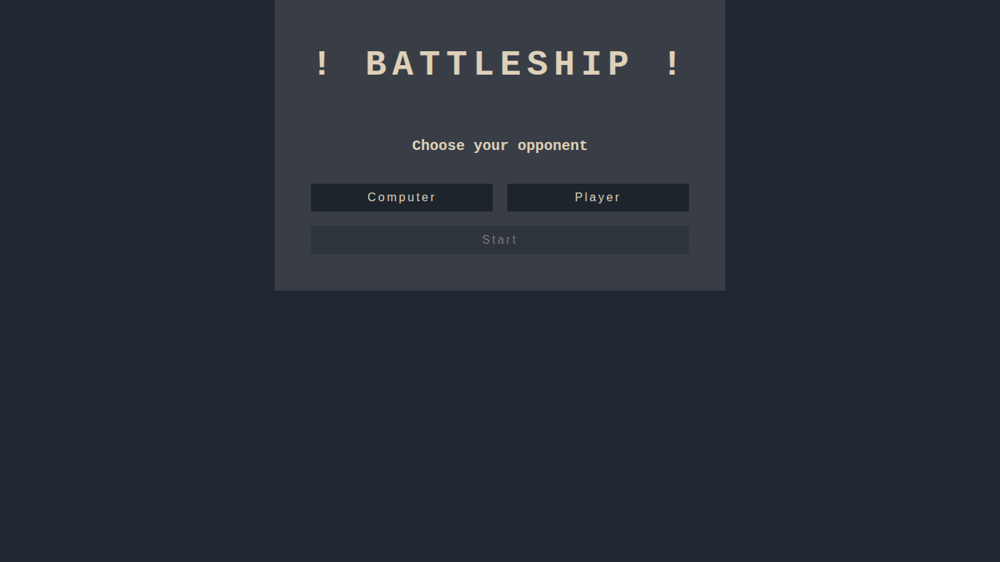
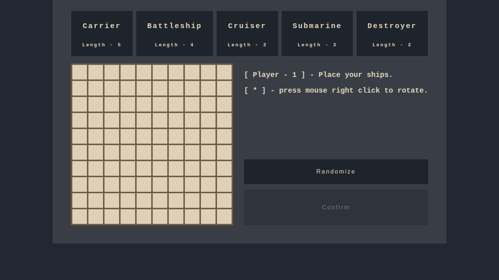
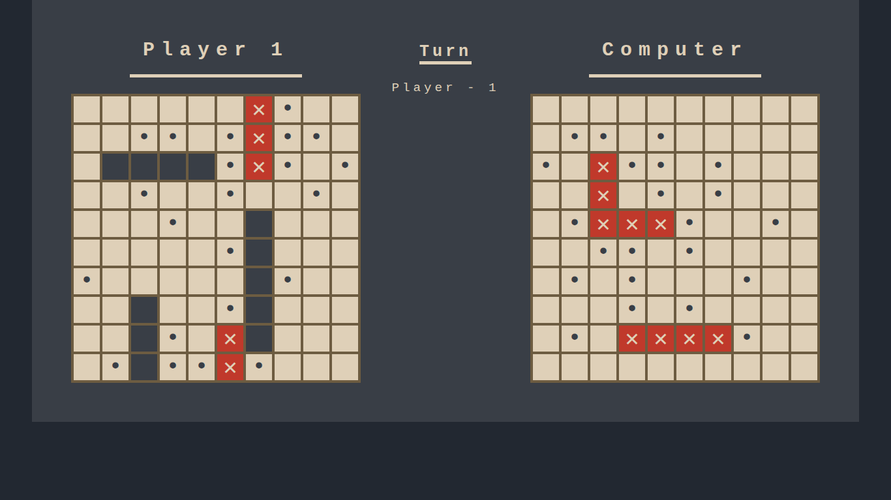

# Battleship







A Battleship game where you can play with a semi smart AI or with another player (passing the screen)


[Live site link](https://jk301.github.io/battleship-odin/)


## Disclaimer

- After you hit a ship in the opponent side you get a consecutive attack. 
- A consecutive attack can be chained it you keep hitting ships.


## Usage

- Just visit the live link and play. No signups/logins required.

## Features

- Well thoughtout pass screens.
- Semi competent AI moves (if attack hits, tries side tiles).
- Used a callback chain to handle page flow.


## Installation (local)

```
git clone https://github.com/jk301/battleship-odin.git
```

```
cd battleship-odin
```

- Since its in a webpack template just install and run.
- All the dependecies are in devDependencies. If you have truble installing, check package.json.


```
npm install
```

```
npm run dev
```
